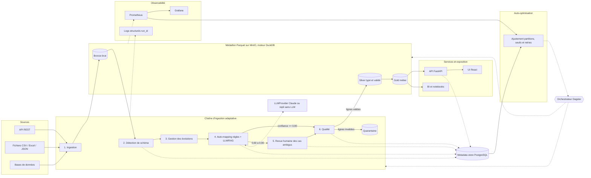

# Architecture de la plateforme ADP

La plateforme ingère des sources hétérogènes et s'adapte seule à leurs évolutions : un nouveau fichier ou un changement de schéma est détecté, mappé (règles puis LLM/RAG), contrôlé et publié de Bronze à Gold. L'humain n'intervient que sur les cas ambigus (confiance entre 0,60 et 0,90, H-02).

## Vue d'ensemble

## Blocs

- **Ingestion** : connecteurs par type de source ; écriture brute append-only en Bronze avec `run_id` et empreinte du schéma.
- **Détection de schéma et évolutions** : inférence des types, comparaison avec la dernière version connue, classification du changement (ajout, suppression, renommage, changement de type).
- **Auto-mapping** : règles déterministes et similarité, puis LLM/RAG sur les cas non résolus ; sorties = propositions validées par schéma (ADR 0006).
- **Qualité et quarantaine** : règles par colonne et par lot ; les lignes invalides sont isolées avec leur motif, jamais supprimées.
- **Médaillon** : Bronze brut, Silver typé et validé, Gold métier (ADR 0001), en Parquet sur MinIO, calculé avec DuckDB (ADR 0002).
- **Metadata store** : schémas, mappings, décisions de revue, résultats qualité, lignée et runs (ADR 0003).
- **Orchestration** : assets, sensors et checks Dagster (ADR 0004).
- **Services et exposition** : API FastAPI, UI React de revue et de suivi, accès BI.
- **Observabilité** : métriques Prometheus, tableaux Grafana, logs JSON corrélés par `run_id`.
- **Auto-optimisation** : boucle qui exploite métriques et historique pour ajuster partitionnement, seuils et retries.

## Décisions d'architecture (ADR)

| N° | Décision | Hypothèse |
|----|----------|-----------|
| 0001 | [Architecture médaillon](adr/0001-medallion.md) | — |
| 0002 | [Stockage Parquet sur MinIO, moteur DuckDB](adr/0002-storage.md) | — |
| 0003 | [Metadata store PostgreSQL](adr/0003-metadata-store.md) | H-04 |
| 0004 | [Orchestration Dagster](adr/0004-orchestration.md) | H-08 |
| 0005 | [Langages : Python MVP, Rust en option](adr/0005-language-stack.md) | H-03 |
| 0006 | [Politique d'usage des LLM](adr/0006-llm-policy.md) | H-02, H-09 |

Les hypothèses restent ouvertes tant que l'utilisateur ne les a pas tranchées (feuille `Hypotheses` du backlog) ; un ADR sera révisé si une décision les contredit.
